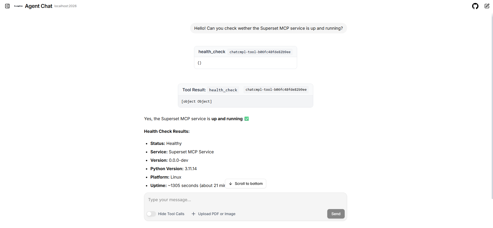

# superset-agent

This project is a LangChain agent served by [Aegra](https://github.com/aegra/aegra). It connects to Apache Superset's MCP server to inspect datasets, query data, and manage Superset objects.

## Requirements

- Git
- Docker Engine with Docker Compose
- [uv](https://docs.astral.sh/uv/)
- [Ollama](https://ollama.com/) for local inference, or an OpenRouter API key

## Quick start

### 1. Configure Superset

Clone the [Apache Superset repository](https://github.com/apache/superset) next to this repository:

```bash
cd ..
git clone https://github.com/apache/superset.git
cd superset-agent
```

The two repositories should be sibling directories:

```text
workspace/
├── superset/
└── superset-agent/
```

In the cloned Superset repository, create
`superset/docker/pythonpath_dev/superset_config_docker.py` with:

```python
MCP_AUTH_ENABLED = False
MCP_API_KEY_ENABLED = False
MCP_DEV_USERNAME = "admin"
```

Superset ignores this local override file. `MCP_DEV_USERNAME` must name an
existing Superset user. The default Docker initialization creates the `admin`
user used here.

The non-development Compose configuration disables example loading by default.
Create `superset/docker/.env-local`, which is also ignored by the Superset
repository, and enable the built-in examples before the first startup:

```dotenv
SUPERSET_LOAD_EXAMPLES=yes
```

Create `docker-compose.mcp.yml` in the Superset repository root:

```yaml
services:
  superset-mcp:
    build:
      context: .
      target: dev
    command: ["superset", "mcp", "run", "--host", "0.0.0.0", "--port", "5008"]
    user: "root"
    restart: unless-stopped
    ports:
      - "5008:5008"
    env_file:
      - path: docker/.env
        required: true
      - path: docker/.env-local
        required: false
    depends_on:
      superset-init:
        condition: service_completed_successfully
    volumes:
      - ./docker:/app/docker
      - superset_home:/app/superset_home
```

This file joins the MCP container to the normal Superset Compose project
network. Compose merges files in the order provided, so keep the Superset
Compose file first and `docker-compose.mcp.yml` second.

Build and start Superset together with the MCP service:

```bash
docker compose \
  -f ../superset/docker-compose-non-dev.yml \
  -f ../superset/docker-compose.mcp.yml \
  up -d --build
```

The one-shot `superset-init` service applies migrations, creates the default
`admin` user, initializes permissions, and runs `superset load_examples` when
`SUPERSET_LOAD_EXAMPLES=yes`. Loading the examples can take several minutes.
Check its result with:

```bash
docker compose \
  -f ../superset/docker-compose-non-dev.yml \
  -f ../superset/docker-compose.mcp.yml \
  ps -a superset-init

docker compose \
  -f ../superset/docker-compose-non-dev.yml \
  -f ../superset/docker-compose.mcp.yml \
  logs superset-init superset-mcp
```

Continue after `superset-init` exits with status `0`. Superset should then have
an `examples` database connection and built-in datasets such as
`wb_health_population`. The source data is maintained in the
[Superset examples-data repository](https://github.com/apache-superset/examples-data).

The local endpoints used by this project are:

- Superset: `http://localhost:8089`
- Superset MCP: `http://localhost:5008/mcp`

### 2. Configure the agent

```bash
cd agent
cp .env.example .env
```

Keep the MCP API key empty and select a Superset example dataset that exists in your instance:

```dotenv
SUPERSET_MCP_URL="http://localhost:5008/mcp"
SUPERSET_MCP_API_KEY=""
SUPERSET_DEFAULT_DATASET="wb_health_population"
```

With no key, [`create_tools`](agent/src/agent/tools.py) gives the MCP URL directly to `MCPAdapter`. Superset runs those calls as the configured `MCP_DEV_USERNAME`.

### 3. Select a model

Ollama is the default provider:

```dotenv
PROVIDER="ollama"
OLLAMA_MODEL="LiquidAI/lfm2.5-2.6b:q4_k_m"
OLLAMA_HOST="http://127.0.0.1:11434"
OLLAMA_NUM_CTX="32768"
```

Pull the model before starting the agent. Default model is Q4 K M quantized version of LFM-2.5-2.6b:

```bash
ollama pull LiquidAI/lfm2.5-2.6b:q4_k_m
```

To use OpenRouter instead:

```dotenv
PROVIDER="openrouter"
OPENROUTER_API_KEY="your-openrouter-key"
OPENROUTER_MODEL="liquid/lfm-2.5-2.6b:free"
```

### 4. Start the agent

For quick development start with hot reload via aegra commands:

```bash
uv sync
uv run aegra dev
```

Check the service:

```bash
curl --fail http://localhost:2026/health
```

### 5. Chat with the agent

After Aegra is running, you can interact with the agent through [LangChain Agent Chat UI](https://github.com/langchain-ai/agent-chat-ui) via their deployed site [agentchat.vercel.app](https://agentchat.vercel.app). In the connection form, use:

- Deployment URL: `http://localhost:2026`
- Assistant / Graph ID: `superset_agent`



A LangSmith API key is not required when connecting to the local Aegra server.

## Local development

For further local development and testing, especially for security implementation, first complete the database, Superset roles, users, and RLS setup in the [fixture README](fixture/README.md).

### 1. Enable API keys in Superset

In `superset/docker/pythonpath_dev/superset_config.py` at `FEATURE_FLAGS` dictionary, enable the management UI:

```python
FEATURE_FLAGS = {
    # Existing flags...
    "FAB_API_KEY_ENABLED": True,
}
```

In `superset/docker/pythonpath_dev/superset_config_docker.py`, use:

```python
MCP_AUTH_ENABLED = False
FAB_API_KEY_ENABLED = True
MCP_API_KEY_ENABLED = True
MCP_DEV_USERNAME = None
MCP_RBAC_ENABLED = True
```

`MCP_AUTH_ENABLED` controls JWT authentication. API-key authentication is
enabled separately. If you started the services with the quick-start
configuration, recreate the web and MCP services after changing this file:

```bash
docker compose \
  -f ../superset/docker-compose-non-dev.yml \
  -f ../superset/docker-compose.mcp.yml \
  up -d \
  --no-deps \
  --force-recreate \
  superset superset-mcp
```

Verify that the MCP container loaded the Docker configuration and enabled authentication:

```bash
docker compose \
  -f ../superset/docker-compose-non-dev.yml \
  -f ../superset/docker-compose.mcp.yml \
  exec superset-mcp \
  test -f /app/docker/pythonpath_dev/superset_config_docker.py \
  && echo "config mount OK"

docker compose \
  -f ../superset/docker-compose-non-dev.yml \
  -f ../superset/docker-compose.mcp.yml \
  logs superset-mcp 2>&1 \
  | grep "Configured FastMCP instance" \
  | tail -1
```

The final log line should include `auth=True`.

Synchronize Superset's permission records after enabling the API-key feature:

```bash
docker compose \
  -f ../superset/docker-compose-non-dev.yml \
  -f ../superset/docker-compose.mcp.yml \
  exec superset \
  superset init
```

Run this once after enabling the feature. Without it, the `ApiKey` permissions may not appear in the role editor.

### 2. Create a key for the selected Superset user

In Superset, create a small role such as `MCP API Key Self Service` and give it these permissions:

- `can list on ApiKey` (`can_list`)
- `can create on ApiKey` (`can_create`)
- `can get on ApiKey` (`can_get`)
- `can revoke on ApiKey` (`can_revoke`)

Assign the role to the test user. Then sign in as that user and open **Info > API Keys > + API Key**.

For ordinary agent development, place one user's key in `agent/.env`:

```dotenv
SUPERSET_MCP_URL="http://localhost:5008/mcp"
SUPERSET_MCP_API_KEY="sst_key_owned_by_mcp_sales_na"
SUPERSET_DEFAULT_DATASET="mcp_test_sales.orders"
```

The key determines the Superset user for that agent process. Superset then applies that user's roles, dataset permissions, and RLS rules. To work as another user, use that user's key and restart the agent.

For the integration suite, keep separate ignored environment values:

```dotenv
SUPERSET_MCP_API_KEY_PUBLIC="sst_..."
SUPERSET_MCP_API_KEY_SALES_NA="sst_..."
SUPERSET_MCP_API_KEY_SALES_NA_SQL="sst_..."
SUPERSET_MCP_API_KEY_ACME="sst_..."
```

Never commit the real key values.

## Tests (WIP)

Run the integration test:

```bash
cd agent
E2E=1 uv run pytest -s tests/test_agent.py
```

Run the direct security example after completing the authenticated fixture setup:

```bash
cd agent
E2E=1 uv run pytest -s \
  tests/test_security.py
```

The security test uses the `mcp_sales_na` API key and directly calls `list_datasets`. It checks that the sales datasets are visible and that `payroll` and `access_audit` are hidden. Direct MCP calls are used for authorization assertions because they do not depend on an LLM's wording or tool choice.

## Shared compose stack (WIP)

[`agent/compose.superset.yml`](agent/compose.superset.yml) runs Aegra against the cloned Superset checkout's PostgreSQL and MCP services. It expects an external network named `superset-agent-shared`, plus the `superset-postgres` and `superset-mcp` aliases in the merged Superset Compose project.

Create the network once:

```bash
docker network create superset-agent-shared
```

A fresh Superset clone does not define those network aliases. Extend
`superset/docker-compose.mcp.yml` with a `db` override and shared-network
configuration. Keep the existing `superset-mcp` settings in that file and add
the fields shown below:

```yaml
services:
  db:
    image: pgvector/pgvector:pg17-trixie
    networks:
      default:
      agent_shared:
        aliases:
          - superset-postgres

  superset-mcp:
    networks:
      default:
      agent_shared:
        aliases:
          - superset-mcp

networks:
  agent_shared:
    name: superset-agent-shared
    external: true
```

Apply the Compose changes before starting the agent stack:

```bash
docker compose \
  -f ../superset/docker-compose-non-dev.yml \
  -f ../superset/docker-compose.mcp.yml \
  up -d \
  --force-recreate \
  db superset-mcp
```

The Aegra database is separate from the fixture database. Create it in Superset's PostgreSQL instance:

```bash
docker exec -it superset_db psql -U superset -d postgres
```

```sql
CREATE ROLE superset_agent LOGIN PASSWORD 'choose-a-password';
CREATE DATABASE superset_agent OWNER superset_agent;
\connect superset_agent
CREATE EXTENSION IF NOT EXISTS vector;
```

Set the matching `POSTGRES_*` values in `agent/.env`, then start the stack:

```bash
cd agent
docker compose -f compose.superset.yml up -d --build
```

[`agent/docker-compose.yml`](agent/docker-compose.yml) instead runs the agent with its own PostgreSQL and Redis services when the Superset MCP endpoint is hosted separately.
